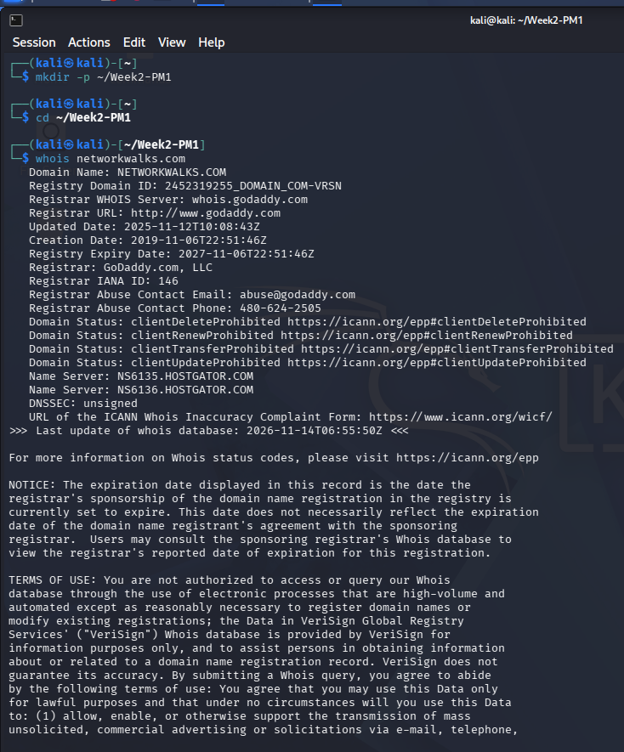
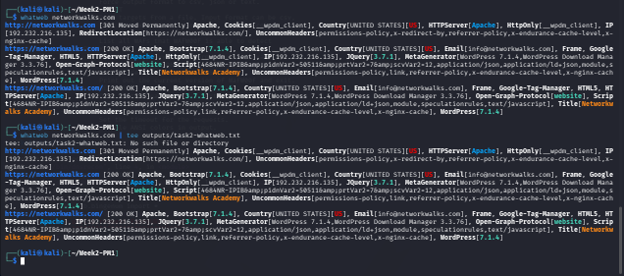
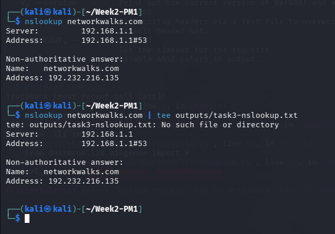
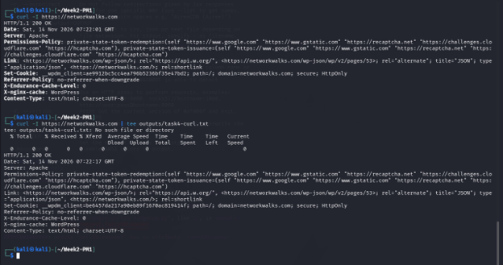
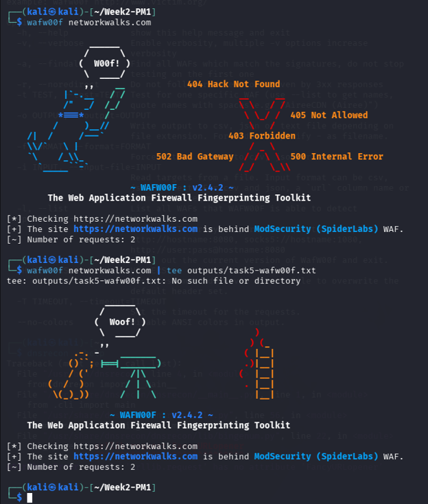
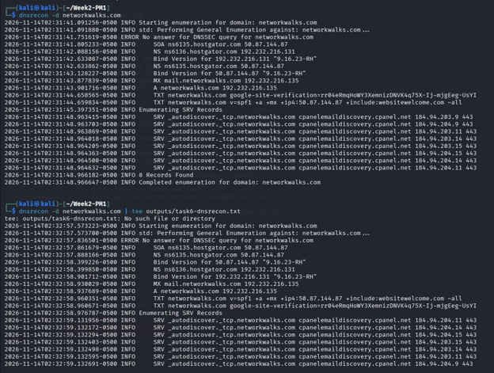
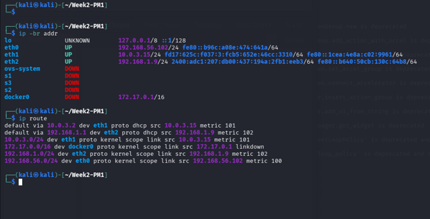
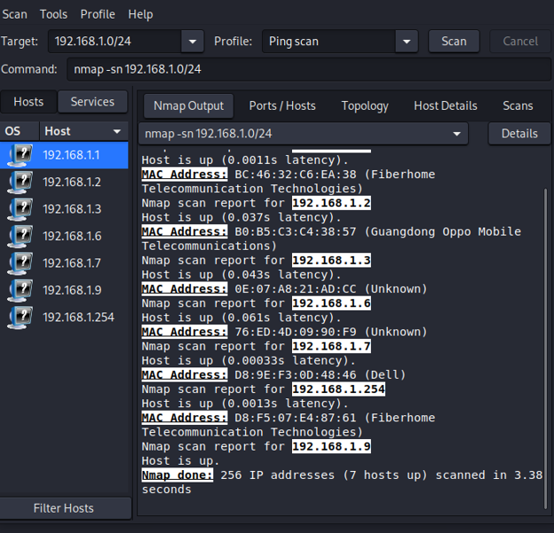
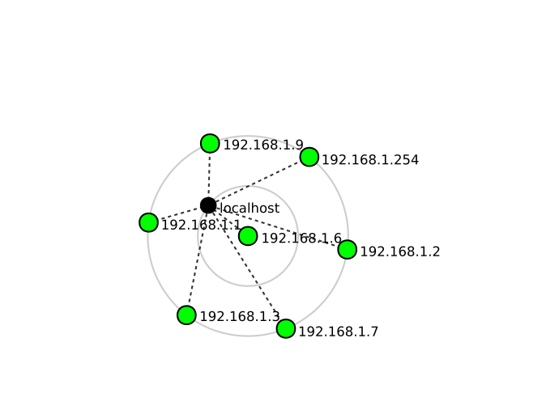

# NetworkWalks Cybersecurity Internship – Week 2

## Project Overview
This repository documents Week 2 practical activities covering footprinting, reconnaissance, and network scanning using Kali Linux.

## Modules
- W2-PM1: Footprinting and Reconnaissance
- W2-PM5: Network Scanning with Zenmap
- W2-PM-FINAL: Penetration Testing Report

## Tools Used
Kali Linux, WHOIS, WhatWeb, NSLookup, cURL, WAFW00F, DNSRecon, Zenmap and Nmap.

## W2-PM1: Footprinting and Reconnaissance

### 1. WHOIS – Domain Information

### 2. WhatWeb – Technology Fingerprinting

### 3. NSLookup – DNS Resolution

### 4. cURL – HTTP Headers

### 5. WAFW00F – WAF Detection

### 6. DNSRecon – DNS Enumeration

## W2-PM5: Network Scanning

### Network Configuration

### Zenmap Ping Scan

### Network Topology

## Final Report
[View Week 2 Penetration Testing Report](reports/Networkwalks_Week2_Penetration_Testing_Report_Amaan.docx)

## Learning Outcomes
- Domain reconnaissance and DNS enumeration
- Web technology and WAF identification
- HTTP header analysis
- Local network discovery
- Network topology visualization
- Security reporting and documentation

## Disclaimer
This repository is for educational purposes and authorized security testing only. The evidence and report should be attributed to the person who performed the documented work.
